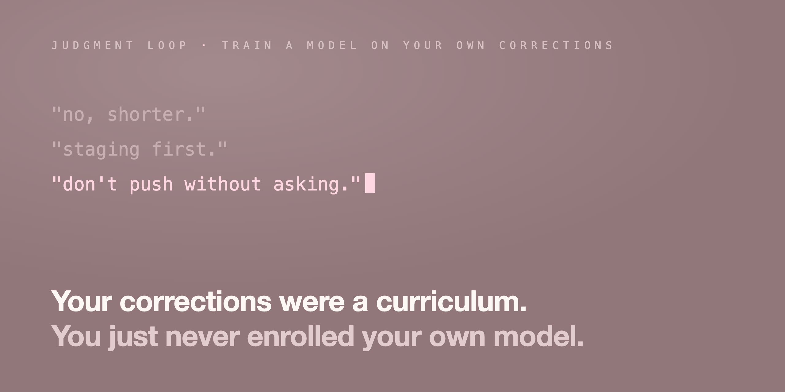

# Judgment Loop



Your corrections were a curriculum. You just never enrolled your own model.

## The prompt, the notebook, the blind test

If you came from the video, these are the three things:

1. **The prompt** — [`prompt/extraction-prompt.md`](prompt/extraction-prompt.md), or use the
   [Google Sheet template](https://docs.google.com/spreadsheets/d/1CdrKHDUEvt6gM4lgEKufdj68Vd8eP787UlcurEy3HZs/edit?gid=2073357882#gid=2073357882)
   (File → Make a copy) — it has the prompt plus the dataset, hidden-test,
   and scoring tabs ready to fill.
2. **The notebook** — [`notebook/train_judgment_model.ipynb`](notebook/train_judgment_model.ipynb).
   Open in Google Colab, free T4 GPU, upload your dataset, run top to
   bottom, download your model. No ML background needed.
3. **The blind test** — [`eval/blind_ab.py`](eval/blind_ab.py). Your model
   vs the generic base model, and vs the base model with your decisions
   pasted into its prompt. Same questions, judged without labels. A loss is
   a valid result — publish either way.

Everything runs free: the extraction in your existing AI assistant, the
training on Colab's free tier, the model on your own laptop via Ollama.

Judgment Loop is a small framework for turning the decisions you keep
repeating at your AI assistant — "no, shorter", "staging first", "don't push
without asking" — into a private specialist model you own, then testing it
honestly against the generic base model.

The goal is not a clone of you. It is a falsifiable test: does a model you
control preserve your repeated decisions on unseen situations better than a
generic model? A loss is a valid result. Publish it either way.

## The loop

1. **Extract** — run `prompt/extraction-prompt.md` in your AI assistant. It
   searches whatever history the assistant can actually access and returns up
   to 20 repeated decisions with evidence.
2. **Dataset** — fill the `Decision Dataset` tab in
   `sheet/Judgment-Loop-Test-Sheet.xlsx`. Mark most rows `Train`, hold a few
   out as `Test`. Download the tab as CSV, then:

   ```
   python3 data/import_sheet.py decisions.csv     # -> data/decisions.jsonl
   ```

   Or skip the sheet: copy `data/decisions.example.jsonl` to
   `data/decisions.jsonl` and edit it.
3. **Expand** — copy `data/examples.example.jsonl` to `data/examples.jsonl`
   and write 3–5 novel scenarios per Train decision, each tagged with its
   `decision_id`. Include a few `"kind": "exception"` examples: cases where
   the decision should *not* fire. Then:

   ```
   python3 data/build_dataset.py    # -> data/decisions-train.jsonl + manifest
   ```

   The build refuses any example that uses a held-out decision.
4. **Train** — open `notebook/train_judgment_model.ipynb` in Google Colab
   (free T4 GPU), upload the JSONL, run top to bottom. Download the GGUF,
   the LoRA adapter zip, and `train-manifest.json`.
5. **Deploy** — put the GGUF next to `notebook/Modelfile`, then
   `ollama create my-judgment -f Modelfile`. Inference is now fully local.
   Turn off Wi-Fi and ask it something. It still answers.
6. **Test blind** — write unseen scenarios in `eval/hidden-tests.jsonl`
   (or import the `Hidden Test Set` tab with `data/import_sheet.py`), then:

   ```
   ollama pull qwen2.5:3b-instruct   # the comparison base model (one-time)
   python3 eval/blind_ab.py check    # validates tests, flags leakage, no model calls
   python3 eval/blind_ab.py run      # asks every arm, shuffles A/B/C
   # judge blind in eval/blind_pairs.csv: fill rank_* (1 = closest to your call)
   python3 eval/blind_ab.py reveal   # unmasks, prints the result, writes results.json
   ```

   `reveal` also prints rows for the sheet's `Blind Comparison` tab, one
   baseline at a time, if you want the `Results` tab as a screenshot.

## Reading the result

**Three arms.** Every question goes to:

| Arm | What it is | What beating it proves |
|---|---|---|
| My model | your fine-tune | — |
| Base model | the generic base, same system prompt | the fine-tune changed something |
| Base + decisions | the generic base with your Train decisions written into its prompt | the fine-tune beats the cheap alternative |

The third arm is the one that matters. With 20 decisions you can paste them
all into a prompt for free. If your fine-tune can't beat that, say so.

**Three suites.** Each test names its `suite`:

| Suite | The test is | It measures |
|---|---|---|
| `seen` | a new scenario for a decision you trained on | application — did it learn the decision? |
| `unseen` | a scenario for a held-out decision | transfer — does it generalise your taste? |
| `exception` | a scenario where a trained decision should not fire | over-triggering — rule, or reflex? |

Expect `seen` to be the easiest win and `unseen` the hardest. Report them
separately; a blended number hides which one you actually have.

**The verdict.** `reveal` prints wins, losses and ties with a 95% interval,
and one of:

- `WIN` / `LOSS` — at least 30 decided tests and an exact sign test below 0.05.
- `INCONCLUSIVE` — enough tests, but too close to call.
- `TOO FEW TESTS` — fewer than 30 decided. A 4–0 record is a lean, not a result.

Change the bar in `judgment.config.json` if you must, and say that you did.

## Rules that keep the result honest

- The held-out decisions never appear in training data, paraphrased or
  otherwise. `build_dataset.py` rejects examples tagged with a held-out
  decision and flags test questions that are near-copies of a training
  scenario. That check is lexical: a careful paraphrase still gets through,
  so the `Leakage check` column in the sheet is still yours to fill.
- One prompt, one place. The system prompt lives in `judgment.config.json`.
  Training data, the Modelfile and the blind test all read it from there.
  "My model" and "Base model" get the identical prompt; "Base + decisions"
  gets the same prompt plus your Train decisions, and nothing else.
- Judge blind. `blind_ab.py` hides which answer came from which arm until
  after you have ranked them. Your fine-tune may have a recognisable voice;
  rank on whether the *call* is yours, not on whether it sounds like you.
- Temperature 0, fixed seed. One answer per arm per question.
- Do not invent numbers. `eval/results.json` is the claim; publish it as-is.
- Curate before you upload. Training on Colab sends your dataset to a cloud
  VM — strip names, keys, and anything private first. The model you download
  afterward is yours and runs offline.

## What you need

- Any AI assistant that can search your history (for the extraction prompt)
- A Google account (Colab, free tier is enough for a 3B model)
- [Ollama](https://ollama.com) on your machine, with the base model pulled
  for the blind test: `ollama pull qwen2.5:3b-instruct`
- Python 3.8+ (standard library only)

**Base model licence.** The default base, Qwen2.5-3B, is released under the
Qwen Research License, which covers non-commercial use only. Fine for a
personal experiment; check the licence before you build anything commercial
on the weights. The base is one line in `judgment.config.json` and one in
the notebook — swap it for an Apache-2.0 model if you need to.

## Roadmap through the repo

Six steps. Each step leaves you holding one artifact you didn't have before.

| Step | You do | File | You leave with |
|---|---|---|---|
| 1 · Extract | Run the prompt in your AI assistant | `prompt/extraction-prompt.md` | up to 20 repeated decisions, with dates and evidence |
| 2 · Dataset | Fill the Decision Dataset tab, mark Train/Test, import | `data/import_sheet.py` | `data/decisions.jsonl` — your judgment corpus + a clean holdout |
| 3 · Expand | Write 3–5 novel scenarios per Train decision | `data/build_dataset.py` | `decisions-train.jsonl` + a manifest with its hash |
| 4 · Train | Run the notebook on a Colab GPU (free T4) | `notebook/train_judgment_model.ipynb` | `my-judgment-q4_k_m.gguf`, the LoRA adapter, `train-manifest.json` |
| 5 · Deploy | `ollama create my-judgment -f Modelfile` | `notebook/Modelfile` | a specialist that answers with Wi-Fi off |
| 6 · Test blind | Author unseen tests, check, run, judge, reveal | `eval/blind_ab.py` + `eval/hidden-tests.jsonl` | `eval/results.json` — a verdict per baseline and per suite |

The order matters: the holdout in step 2 is what makes the number in step 6
honest. If you skip the split, you're grading the model on its homework.

## Maintaining it

Decisions change. In `data/decisions.jsonl`:

- Reversed a decision? Set the old row to `"status": "retired"` and
  `"superseded_by": "<new id>"`. Its examples stop being trained on; the
  history stays.
- Found an exception? Put it in the decision's `exceptions` field and add
  an `exception` example and an `exception` test.

The dataset and the tests are the asset. The weights are a build: the
manifests tie every model and every result back to the exact data and
config that produced them.

Tests for the harness itself: `python3 -m unittest discover -s tests`.

## Where this goes (planned, not promised)

- **Local training** — replace the Colab step with LoRA training on your own
  machine, so the dataset never leaves it.
- **Correction mining** — a script that digs real correction moments ("no,
  shorter", "don't push") out of your own session transcripts and curates
  them into training pairs. The highest-signal data source; currently a
  manual step.
- **Fidelity rubric** — a structured scoring guide for step 6 so two people
  judging the same answers land on similar scores.
- **Weekly loop** — re-extract, append fresh corrections, retrain, and only
  promote a new model if it beats the current one on a frozen test set.

Issues and PRs welcome — especially your blind-test results, wins or losses.
